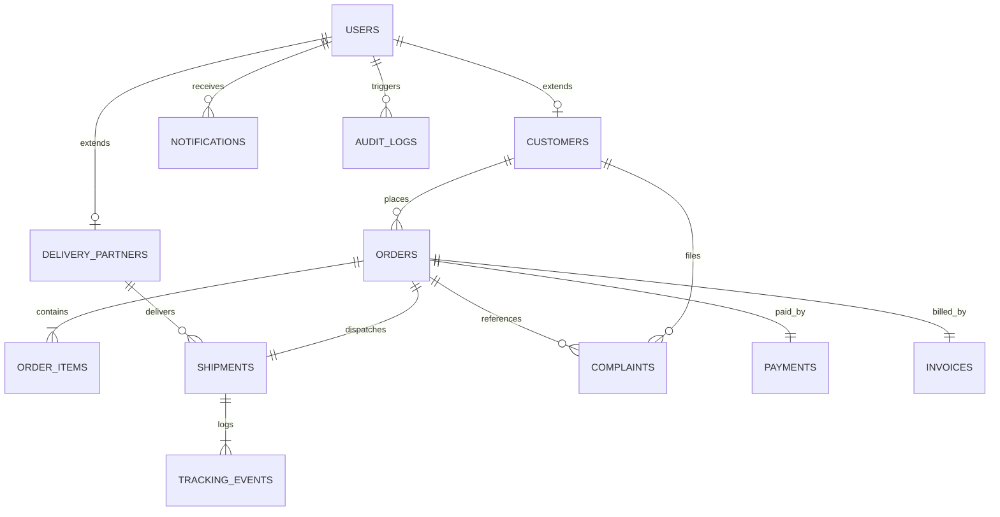

# TrackCart – Database Schema Documentation

PostgreSQL Database Name: `trackcart_db`

---

## 1. Entity Specifications

### `users`
Core user identity and authentication credentials table.
- `id` (BIGSERIAL, Primary Key)
- `email` (VARCHAR(120), UNIQUE, NOT NULL) - Indexed
- `password` (VARCHAR(255), NOT NULL) - BCrypt hash
- `full_name` (VARCHAR(100), NOT NULL)
- `phone` (VARCHAR(30))
- `role` (VARCHAR(30), NOT NULL) - `ADMIN`, `CUSTOMER`, `DELIVERY_PARTNER`
- `status` (VARCHAR(30), DEFAULT 'ACTIVE')
- `created_at`, `updated_at` (TIMESTAMP WITH TIME ZONE)

### `customers`
Extends `users` with shipping address and consumer profile data.
- `id` (BIGSERIAL, Primary Key)
- `user_id` (BIGINT, UNIQUE, Foreign Key -> `users.id`)
- `shipping_address` (VARCHAR(255))
- `city` (VARCHAR(100))
- `state` (VARCHAR(100))
- `postal_code` (VARCHAR(30))
- `country` (VARCHAR(100), DEFAULT 'India')

### `delivery_partners`
Extends `users` with vehicle and fleet telemetric profile.
- `id` (BIGSERIAL, Primary Key)
- `user_id` (BIGINT, UNIQUE, Foreign Key -> `users.id`)
- `vehicle_type` (VARCHAR(50))
- `vehicle_number` (VARCHAR(50))
- `license_number` (VARCHAR(50))
- `current_lat` (DOUBLE PRECISION)
- `current_lng` (DOUBLE PRECISION)
- `is_available` (BOOLEAN, DEFAULT TRUE)
- `rating` (DOUBLE PRECISION, DEFAULT 5.0)
- `completed_deliveries` (INT, DEFAULT 0)

### `orders`
E-commerce orders and transactional status.
- `id` (BIGSERIAL, Primary Key)
- `order_number` (VARCHAR(50), UNIQUE, NOT NULL) - Indexed
- `customer_id` (BIGINT, Foreign Key -> `customers.id`)
- `total_amount` (NUMERIC(12,2), NOT NULL)
- `tax_amount` (NUMERIC(12,2))
- `shipping_fee` (NUMERIC(12,2))
- `final_amount` (NUMERIC(12,2), NOT NULL)
- `status` (VARCHAR(40), NOT NULL) - `PENDING`, `CONFIRMED`, `SHIPPED`, `OUT_FOR_DELIVERY`, `DELIVERED`, `CANCELLED`
- `payment_status` (VARCHAR(40), NOT NULL) - `PENDING`, `PAID`, `REFUNDED`
- `shipping_address`, `city`, `state`, `postal_code` (VARCHAR)
- `estimated_delivery_date` (TIMESTAMP WITH TIME ZONE)
- `delivery_notes` (TEXT)
- `created_at`, `updated_at` (TIMESTAMP WITH TIME ZONE)

### `order_items`
Individual line items purchased within an order.
- `id` (BIGSERIAL, Primary Key)
- `order_id` (BIGINT, Foreign Key -> `orders.id` ON DELETE CASCADE)
- `product_name` (VARCHAR(150), NOT NULL)
- `sku` (VARCHAR(60))
- `unit_price` (NUMERIC(12,2), NOT NULL)
- `quantity` (INT, NOT NULL)
- `subtotal` (NUMERIC(12,2), NOT NULL)
- `image_url` (VARCHAR(255))

### `shipments`
Physical logistics dispatch and carrier tracking unit.
- `id` (BIGSERIAL, Primary Key)
- `tracking_number` (VARCHAR(60), UNIQUE, NOT NULL) - Indexed
- `order_id` (BIGINT, UNIQUE, Foreign Key -> `orders.id`)
- `delivery_partner_id` (BIGINT, Nullable, Foreign Key -> `delivery_partners.id`)
- `status` (VARCHAR(40), NOT NULL) - `MANIFESTED`, `CONFIRMED`, `PACKED`, `PICKED_UP`, `SHIPPED`, `IN_TRANSIT`, `OUT_FOR_DELIVERY`, `DELIVERED`, `DELAYED`, `FAILED`
- `carrier_name` (VARCHAR(100), DEFAULT 'TrackCart Express')
- `pickup_time` (TIMESTAMP WITH TIME ZONE)
- `delivered_time` (TIMESTAMP WITH TIME ZONE)
- `estimated_delivery_date` (TIMESTAMP WITH TIME ZONE)
- `is_delayed` (BOOLEAN, DEFAULT FALSE)
- `delay_reason` (TEXT)

### `tracking_events`
Milestone log of sequential tracking status changes.
- `id` (BIGSERIAL, Primary Key)
- `shipment_id` (BIGINT, Foreign Key -> `shipments.id` ON DELETE CASCADE)
- `status` (VARCHAR(50), NOT NULL)
- `location` (VARCHAR(150))
- `description` (TEXT, NOT NULL)
- `event_timestamp` (TIMESTAMP WITH TIME ZONE)
- `actor_role` (VARCHAR(40), NOT NULL)

### `complaints`
Dispute and customer support tickets.
- `id` (BIGSERIAL, Primary Key)
- `ticket_number` (VARCHAR(50), UNIQUE, NOT NULL)
- `customer_id` (BIGINT, Foreign Key -> `customers.id`)
- `order_id` (BIGINT, Nullable, Foreign Key -> `orders.id`)
- `subject` (VARCHAR(200), NOT NULL)
- `description` (TEXT, NOT NULL)
- `priority` (VARCHAR(30)) - `LOW`, `MEDIUM`, `HIGH`, `URGENT`
- `status` (VARCHAR(30)) - `OPEN`, `INVESTIGATING`, `RESOLVED`, `CLOSED`
- `resolution_notes` (TEXT)
- `resolved_at` (TIMESTAMP WITH TIME ZONE)
- `created_at` (TIMESTAMP WITH TIME ZONE)

### `payments`
Financial transaction authorization record.
- `id` (BIGSERIAL, Primary Key)
- `transaction_id` (VARCHAR(100), UNIQUE, NOT NULL)
- `order_id` (BIGINT, UNIQUE, Foreign Key -> `orders.id`)
- `amount` (NUMERIC(12,2), NOT NULL)
- `payment_method` (VARCHAR(50), NOT NULL)
- `status` (VARCHAR(40), NOT NULL)
- `paid_at` (TIMESTAMP WITH TIME ZONE)

### `invoices`
Tax compliance and official billing document references.
- `id` (BIGSERIAL, Primary Key)
- `invoice_number` (VARCHAR(50), UNIQUE, NOT NULL)
- `order_id` (BIGINT, UNIQUE, Foreign Key -> `orders.id`)
- `invoice_date` (TIMESTAMP WITH TIME ZONE)
- `total_amount` (NUMERIC(12,2), NOT NULL)
- `tax_amount` (NUMERIC(12,2), NOT NULL)
- `pdf_url` (VARCHAR(255))
- `status` (VARCHAR(30), DEFAULT 'GENERATED')

### `notifications`
User alert and dispatch broadcast records.
- `id` (BIGSERIAL, Primary Key)
- `user_id` (BIGINT, Foreign Key -> `users.id` ON DELETE CASCADE)
- `title` (VARCHAR(150), NOT NULL)
- `message` (TEXT, NOT NULL)
- `type` (VARCHAR(50), NOT NULL) - `ORDER`, `SHIPMENT`, `COMPLAINT`, `SYSTEM`
- `is_read` (BOOLEAN, DEFAULT FALSE)
- `created_at` (TIMESTAMP WITH TIME ZONE)

### `audit_logs`
Immutable compliance ledger.
- `id` (BIGSERIAL, Primary Key)
- `action` (VARCHAR(100), NOT NULL)
- `entity_name` (VARCHAR(100), NOT NULL)
- `entity_id` (VARCHAR(100))
- `performed_by` (VARCHAR(120))
- `ip_address` (VARCHAR(50))
- `details` (TEXT)
- `timestamp` (TIMESTAMP WITH TIME ZONE)
