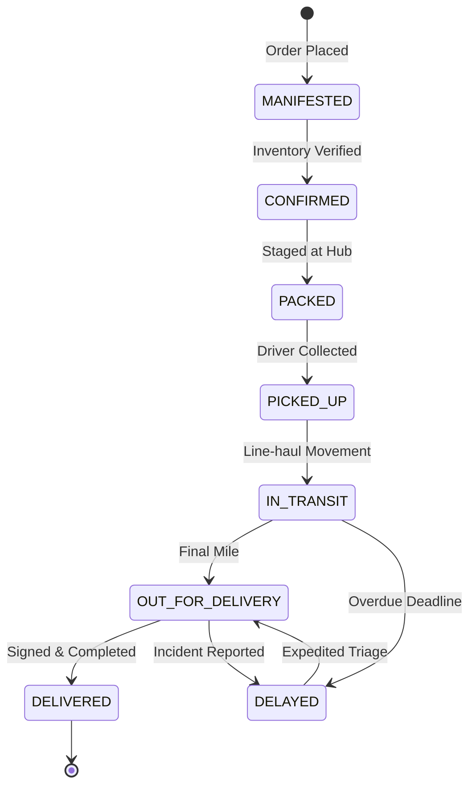

# TrackCart – System Architecture & Technical Design

This document details the enterprise software design, design patterns, separation of concerns, and data flows of the **TrackCart** platform.

```mermaid
flowchart TD
    subgraph Client ["Client Layer (React 18 + Vite)"]
        UI["Tailwind SaaS UI Components"]
        AuthCtx["AuthContext (JWT Session)"]
        Router["React Router v6 Protected Routes"]
        ApiClient["Axios / Fetch REST Client"]
    end

    subgraph Security ["Security & Gateways"]
        CORS["CORS Filter"]
        JWTFilter["JwtAuthenticationFilter"]
        SecConfig["Spring Security RBAC"]
    end

    subgraph Controllers ["Presentation Layer (REST Controllers)"]
        AC["AuthController"]
        OC["OrderController"]
        SC["ShipmentController"]
        DPC["DeliveryPartnerController"]
        CC["ComplaintController"]
        AnC["AnalyticsController"]
        NC["NotificationController"]
    end

    subgraph Services ["Business Logic Layer (Services)"]
        AS["AuthService"]
        OS["OrderService"]
        STS["ShipmentTrackingService"]
        DPS["DeliveryPartnerService"]
        CS["ComplaintService"]
        AnS["AnalyticsService"]
        IS["InvoiceService"]
        DSS["DataSeederService"]
    end

    subgraph Persistence ["Data Access Layer (JPA / Hibernate)"]
        Repos["Spring Data JPA Repositories"]
    end

    subgraph Storage ["Database Engine"]
        DB[("PostgreSQL 16 / H2 Driver")]
    end

    Client --> Security
    Security --> Controllers
    Controllers --> Services
    Services --> Repos
    Repos --> Storage
```

---

## 1. Architectural Principles

1. **Separation of Concerns (SoC)**: Controllers handle HTTP serialization and input validation; Services orchestrate business logic, transactions, and audit trails; Repositories manage database access.
2. **Stateless Security**: Every API request is authenticated independently using cryptographic JSON Web Tokens (JWT) signed with HMAC-SHA256.
3. **Role-Based Access Control (RBAC)**: Fine-grained authorizations enforced through Spring Security method-level checks (`@PreAuthorize("hasRole('ADMIN')")`).
4. **Idempotent Data Seeding**: Automatic demo dataset population on startup with zero external dependency barriers.
5. **Multi-Environment Persistence**: Flexible datasource switching:
   - `dev` profile: In-memory H2 with PostgreSQL compatibility mode for instant developer onboarding without installing PostgreSQL.
   - `prod` profile: Production PostgreSQL 16 dialect with connection pooling.

---

## 2. Core Intelligent Subsystems

### A. 6-Stage Tracking State Machine

### B. Automated Overdue Delay Detector
A background daemon (`@Scheduled(fixedRate = 300000)`) periodically queries active, non-delivered shipments where:
$$\text{Current Timestamp} > \text{Estimated Delivery Date}$$
When an overdue condition is detected:
1. `Shipment.isDelayed` is set to `true`.
2. A milestone `DELAYED` tracking event is added to the historical log.
3. An automated customer alert notification is recorded in the notification table.
4. An entry is appended to `audit_logs`.

---

## 3. Security Architecture
- Password Hashing: BCrypt with 10 salt rounds.
- Tokens: JJWT 0.12.5 signed using secret key with 24-hour expiration.
- CORS Policy: Restricts allowed origins, methods, and headers while permitting preflight requests.
- Protected Endpoints:
  - Public: `/api/auth/**`, `/api/shipments/track/**`, `/api/seed/**`, Swagger UI.
  - Customer: `/api/orders/**`, `/api/complaints/**`, `/api/notifications/**`.
  - Delivery Partner: `/api/delivery-partners/**`, `/api/shipments/{id}/status`.
  - Admin: `/api/analytics/admin-summary`, `/api/shipments/{id}/assign`, `/api/delivery-partners`, `/api/analytics/audit-logs`.
